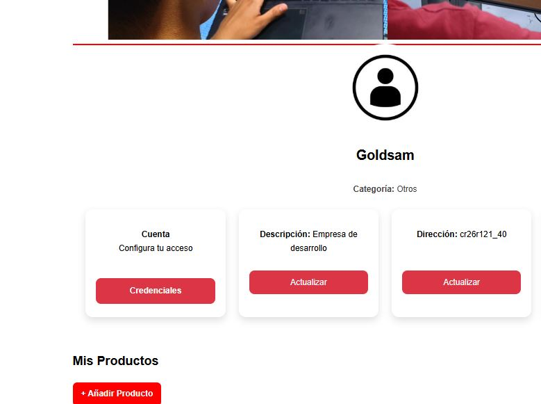
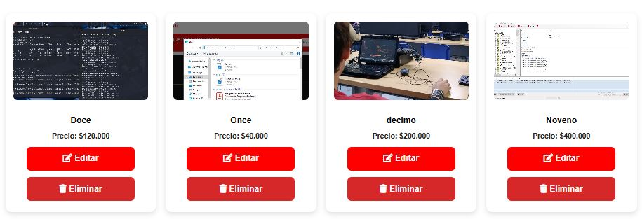

# 🛒 MERCAJUSTO


> **Calidad y frescura a tu alcance** 🌱  
> Plataforma web que conecta proveedores locales con clientes de manera rápida, sencilla y directa.

---

## ✨ Descripción

**MercaJusto** es una aplicación web desarrollada en Laravel que permite a los proveedores locales gestionar sus catálogos de productos y conectar directamente con clientes a través de WhatsApp, promoviendo el comercio justo, local y la digitalización de los pequeños comercios.

---

## 🚀 Características principales

- 🛍️ **Gestión de productos:** Catálogo dinámico organizado por categorías.
- 🧑‍🌾 **Panel de Proveedor:** Panel administrativo exclusivo para gestionar inventarios y productos.
- 🏢 **Perfil Empresarial:** Edición y personalización de la información pública de la empresa/proveedor.
- 📸 **Carga de imágenes:** Integración con Cloudinary para almacenar y servir de forma eficiente las fotos de los productos.
- 📱 **Contacto Directo:** Enlace directo a WhatsApp para que los clientes realicen pedidos de forma instantánea.
- 🗂️ **Categorización:** Clasificación ordenada de los productos.
- 📦 **Control de Inventario:** Control básico de stock y disponibilidad de productos.
- ⚡ **Interfaz Premium:** Navegación fluida y diseño moderno adaptado para dispositivos móviles y escritorio.
- ⚙️ **Soporte integrado:** Sección dedicada para solicitar ayuda o asistencia.

---

## 🧑‍🌾 Funcionalidades del Proveedor

Una vez registrado y aprobado, el proveedor puede:

- ➕ **Crear productos:** Agregar nuevos artículos especificando nombre, precio, descripción, stock e imagen.
- ✏️ **Modificar catálogo:** Actualizar detalles de productos ya creados.
- ❌ **Eliminar productos:** Retirar artículos del catálogo.
- 🏢 **Administrar perfil:** Cambiar datos de contacto, descripción del negocio y logo.
- 📸 **Imágenes en la nube:** Subir fotografías optimizadas que se almacenan automáticamente en la nube.
- 📲 **Recibir pedidos:** Botón de chat directo que abre WhatsApp con un mensaje preconfigurado del pedido.

---

## 🖼️ Vista previa




---

## 🛠️ Tecnologías utilizadas

- **Framework:** Laravel 12
- **Base de datos:** PostgreSQL 15 (Dockerizado)
- **Almacenamiento de imágenes:** Cloudinary
- **Frontend:** Blade + Tailwind CSS (Vite) + JavaScript
- **Contenedores:** Docker & Docker Compose

---

## 📦 Guía de Instalación y Configuración

Sigue estos pasos para levantar el entorno de desarrollo local:

### 1️⃣ Clonar el repositorio

```bash
git clone https://github.com/tuusuario/mercajusto.git
cd mercajusto
```

### 2️⃣ Configurar las variables de entorno

Copia el archivo de plantilla `.env.example` para crear tu `.env` local:

```bash
cp .env.example .env
```

> [!IMPORTANT]
> Abre el archivo `.env` configurado y asegúrate de rellenar los datos de conexión y las credenciales externas (especialmente de **Cloudinary** para la subida de imágenes y **Mail/SMTP** para el envío de notificaciones).

### 3️⃣ Iniciar los contenedores Docker

Levanta la base de datos de PostgreSQL y el servidor de la aplicación:

```bash
docker-compose up -d --build
```

### 4️⃣ Instalar dependencias de PHP (Composer)

Ejecuta el gestor de paquetes de PHP dentro del contenedor de la aplicación:

```bash
docker exec -it laravel_app composer install
```

### 5️⃣ Generar la clave de la aplicación

Genera el token de seguridad `APP_KEY` necesario para encriptar los datos:

```bash
docker exec -it laravel_app php artisan key:generate
```

### 6️⃣ Ejecutar migraciones de la base de datos

Crea la estructura de tablas necesaria en la base de datos de PostgreSQL:

```bash
docker exec -it laravel_app php artisan migrate
```

### 7️⃣ Compilar los assets del Frontend (CSS/JS)

La aplicación utiliza **Vite** y **Tailwind CSS** para compilar el diseño y los estilos. Ejecuta las dependencias de Node.js en tu máquina local (host):

```bash
# Instalar dependencias de Node
npm install

# Iniciar servidor de desarrollo de Vite (Hot Reload)
npm run dev

# O compilar los assets para producción
npm run build
```

---

## 🌐 Acceso al Proyecto

Una vez que Docker y Vite estén corriendo, puedes acceder a la aplicación en:

- 💻 **Aplicación Web:** [http://localhost:8000](http://localhost:8000)
- 🗄️ **Base de datos:** PostgreSQL corriendo en el puerto `5432` con las credenciales de tu `.env`.

---

## 🔒 Seguridad en producción y control de versiones

- 🚫 **Nunca** subas archivos `.env` al repositorio de Git público, ya que contienen llaves API y contraseñas.
- 🚫 Los archivos de respaldo de la base de datos (como `merca.sql` o archivos `.sql`, `.dump`, `.backup`) están excluidos en el archivo `.gitignore` para prevenir fugas de información.

---

## 👥 Créditos y Colaboradores

- **Un proyecto de  Goldsam :D :** 
